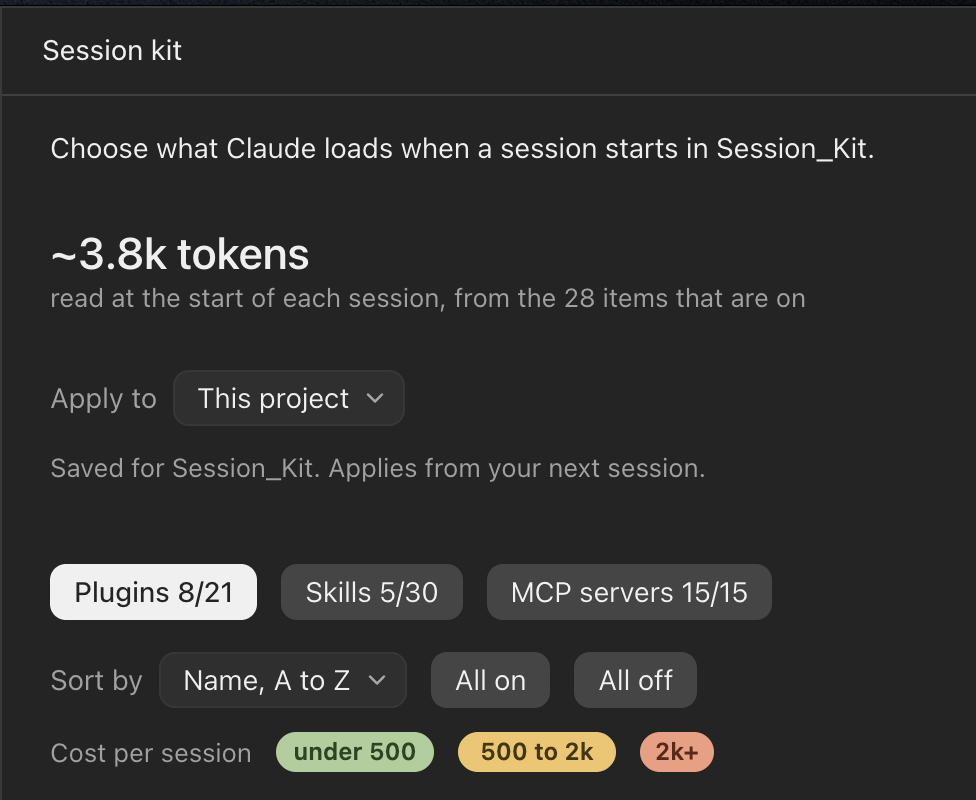
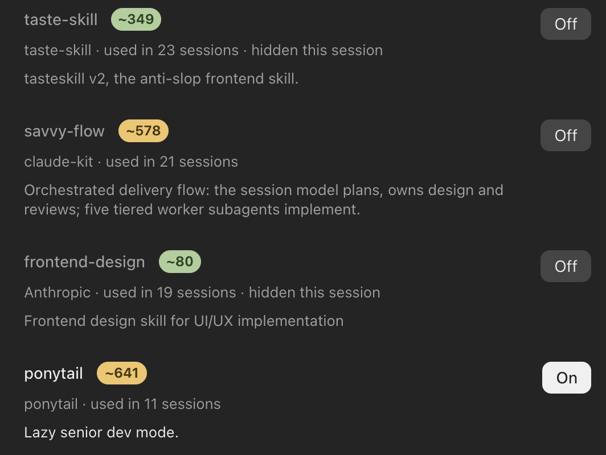

# Claude Session Kit

A Claude Code mod that opens a panel beside the chat for choosing which
plugins, skills and MCP servers load, so a session carries only what the work
needs and spends fewer tokens on lists Claude never uses.

<p align="center">
  
  
</p>

## What it does

- Lists every installed plugin, personal skill (`~/.claude/skills`) and MCP
  server, each with a one-line description, how often past sessions used it,
  and its always-on token cost as a green, amber or red pill.
- Tabs for Plugins, Skills and MCP servers; sort by name, cost, use, or on/off;
  All on and All off per tab.
- Presses are staged. Apply carries them out at the scope chosen under Apply to:
  - This session only: the items are cut from the lists Claude reads at the
    start (skills, agents, tool names, MCP notes, start-of-session hook text),
    and calls to a hidden MCP server are refused. Nothing is saved.
  - This project: written to the project's `.claude/settings.local.json`,
    which outranks the account settings. Applies from the next session.
  - All projects: written to `~/.claude/settings.json`. Applies from the next
    session.
- Presets, from the Preset menu: "Used in this project" switches
  on the plugins and skills this project's past sessions used and the rest
  off; Save as preset stores the current switches under a name, in
  `~/.claude/session-kit-presets.json`, shared by every project. Choosing one stages its
  switches; Apply carries them out. A chosen saved preset can be updated with
  the current switches, renamed, or deleted (after a confirm).
- Minimize closes the panel out of the way; `/session-kit` brings it back. A
  first message sent while minimized opens it again, since Apply and start
  is needed to send it.
- A new session's first message is refused and kept until Apply and start,
  because the session's lists go out with that first request. Apply and start
  then sends the message as the user's own. Closing the panel sends it as it is.

## Install

From GitHub:

```bash
claude plugin marketplace add mrpotatoman-117/claude-session-kit
```

```bash
claude plugin install session-kit@session-kit
```

Start a new session afterwards; the panel opens on its own, and `/session-kit`
reopens it.

## Limits

- A plugin hidden for one session still runs its hooks and keeps its tools;
  only a saved scope unloads it fully.
- MCP deny lists add up across settings files, so a server turned off for all
  projects cannot be turned back on for one project.
- In the Claude desktop app, claude.ai connectors run under their own ids and
  are switched in the app's + menu under Connectors; the panel points there.
- The message Apply and start resends may go without the session's list of
  loadable tools; the next message carries it.
- Tool costs are estimates: plugin costs come from `claude plugin details`,
  skill costs from the length of each description, MCP costs from tool names.

## Tree

```
claude-session-kit/
├── .claude-plugin/marketplace.json   lists the mod for `claude plugin install`
├── plugin/                           the mod itself
│   ├── .claude-plugin/plugin.json    name, version, licence
│   ├── hooks/hooks.json              points Claude Code at register.tsx
│   ├── hooks/register.tsx            the panel, the first-message hold, saving
│   ├── hooks/lists.ts                pure rules: list trimming, settings edits
│   ├── types/index.d.ts              the panel's state
│   └── tests/                        run with `claude plugin test plugin`
├── .claude/                          Claude Code settings for working on this repo
├── CLAUDE.md                         how work in this project is done
├── task.md, log.md, HANDOFF.md       session continuity
└── LICENSE                           MIT
```

## Developing

```bash
claude plugin validate plugin
```

```bash
claude plugin test plugin
```

## License

MIT, see `LICENSE`.
